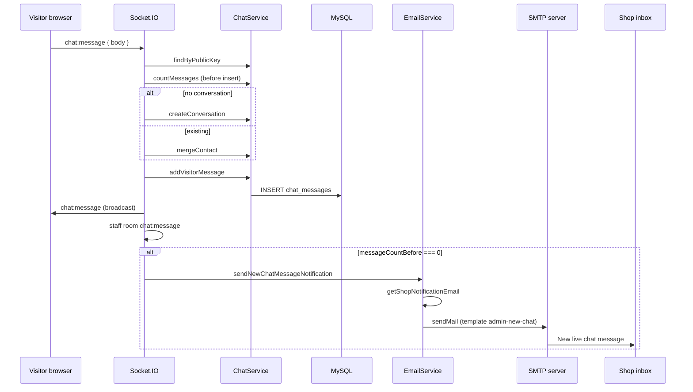

# Live chat (Need Help?) — technical documentation

This document describes all artifacts added or modified to implement **visitor live chat** (storefront widget), **Socket.IO** transport, **MySQL persistence**, and an **admin console** (`/admin/chat`). It is intended so you can **reapply or port the same design to another Node.js / Express / EJS / MySQL project**.

---

## Architecture summary

| Layer | Responsibility |
|--------|----------------|
| **MySQL** | `chat_conversations`, `chat_messages`, `chat_conversation_reads` (per-staff read cursor for unread counts). |
| **Express** | REST: admin JSON APIs; sessions + CSRF on HTTP; **CSRF skipped** for `/socket.io`; same session shared with Socket.IO. |
| **Socket.IO** | Attached to the same `http.Server` / `https.Server` as Express; `io.engine.use(sessionMiddleware)` + `wrapSessionMiddleware` on `io.use`. |
| **Rooms** | Visitors: `conv:{publicKey}`; all staff: `staff`. Events below. |
| **Storefront** | “Need Help?” widget; intro panel (contact + Turnstile) → **compact** panel after first message; `public/js/socket.io.js`. |
| **Admin** | Full-height UI, bubble thread, aligned composer; staff socket + REST refresh; **unread badges** on list + sidebar menu. |
| **Email** | On the **first visitor message** in a conversation, SMTP notification to the shop’s main inbox. |

---

## NPM dependencies

Add to `package.json` `dependencies`:

- **`socket.io`** — server.
- **`socket.io-client`** — copy browser build to static assets (see below).

After `npm install`, copy the browser bundle once (or script it in `postinstall`):

- From: `node_modules/socket.io-client/dist/socket.io.js`
- To: `public/js/socket.io.js` (served same-origin; avoids extra CSP script hosts).

---

## Database

### Migration (TypeScript runner)

**File:** [`data-migration/2026-05-16-create-chat-tables.ts`](../data-migration/2026-05-16-create-chat-tables.ts)

- Creates `chat_conversations` and `chat_messages` with `IF NOT EXISTS`.
- `public_key` `CHAR(36)` unique (visitor identity in `localStorage`).
- Nullable `visitor_first_name`, `visitor_email`, `visitor_phone`.
- `last_message_at` indexed for admin list ordering.
- Messages: `sender` ENUM(`visitor`,`staff`), optional `staff_user_id` FK to `users`.

### SQL mirror (optional reference)

**File:** [`data-migration/sql/2026-05-16-create-chat-tables.sql`](../data-migration/sql/2026-05-16-create-chat-tables.sql)

### Schema snapshot

**File:** [`src/database/schema.sql`](../src/database/schema.sql)

- `DROP TABLE` order updated: `chat_messages`, `chat_conversations` before `users` (FK).
- `CREATE TABLE` for both chat tables appended for greenfield installs.

**Apply:** `npm run migrate` (or your project’s migration runner).

### Migration — staff unread tracking

**File:** [`data-migration/2026-05-22-create-chat-conversation-reads.ts`](../data-migration/2026-05-22-create-chat-conversation-reads.ts)

- Table **`chat_conversation_reads`**: `(staff_user_id, conversation_id)` unique; **`last_read_message_id`** (max message id the staff user has seen in that thread).
- Updated when staff loads messages via **`GET /admin/api/chat/messages`** (`markConversationRead`).
- Unread = visitor messages with `id > last_read_message_id` for that staff user (per conversation).

**Schema snapshot:** [`src/database/schema.sql`](../src/database/schema.sql) includes `chat_conversation_reads` and correct `DROP` order.

---

## Server — TypeScript services

### [`src/services/chatService.ts`](../src/services/chatService.ts) (new)

- **`CHAT_MAX_BODY`** (4000).
- **`isValidPublicChatKey()`** — UUID v4 string validation.
- **`sanitizeContact()`** — trim + max length.
- **`ChatService`**: `findByPublicKey`, `listConversations`, `listConversationsForStaff`, `getTotalUnreadCount`, `markConversationRead`, `countMessages`, `getMessages`, `createConversation`, `mergeContact`, `addVisitorMessage`, `addStaffMessage`.
- **`listConversationsForStaff(staffUserId, limit)`** — list ordered by `last_message_at`; each row includes **`unread_count`** (visitor messages after staff’s read cursor).
- **`getTotalUnreadCount(staffUserId)`** — sum of unread visitor messages across all conversations (menu badge).
- **`markConversationRead(staffUserId, conversationId)`** — upsert `chat_conversation_reads` with `last_read_message_id = MAX(message.id)` for that conversation.
- **`countMessages(conversationId)`** — used for first-message email + Turnstile gate.
- Uses existing `db` pool; `query` results cast where needed for MySQL2 typings.

### [`src/services/chatSocketService.ts`](../src/services/chatSocketService.ts) (new)

- **`attachChatSocket(server, sessionMiddleware)`** — creates `Server` with `path: '/socket.io'`, `cors: { origin: true, credentials: true }`.
- **`io.engine.use(sessionMiddleware)`** — session on Engine.IO handshake.
- **`wrapSessionMiddleware(sessionMiddleware)`** on **`io.use`** — re-runs session on `socket.request` so `socket.request.session` is reliable for staff auth (uses `ServerResponse` shim).
- **Origin guard** — handshake `Origin` host must match `Host` when `Origin` is present.
- **Visitor connections:** `handshake.auth.publicKey` (UUID). Events: `chat:start` (contact), `chat:message` `{ body, turnstileToken? }`. On **first message** when **`isChatTurnstileEnforced()`**, requires **`turnstileToken`** verified by **`verifyTurnstileForChat()`** ([`src/utils/turnstile.ts`](../src/utils/turnstile.ts)); errors `turnstile_required` / `turnstile_failed`. Broadcasts `chat:message` to `conv:{pk}` and `staff`; emits **`chat:list-changed`** `{ publicKey }` to `staff` after visitor messages. First message triggers **`sendNewChatMessageNotification`** (async).
- **Staff connections:** `auth.role === 'staff'`; session user **Super Admin** or **Admin**; joins **`staff`**; emits **`chat:staff-ready`** `{ ok: true }` on success; **`chat:error`** `{ code: 'staff_forbidden' }` then disconnect if role invalid. Event **`staff:message`** `{ publicKey, body }`; also emits **`chat:list-changed`** to `staff`.
- **Payload** (`chat:message`): `publicKey`, `id`, `sender`, `body`, `createdAt`, `staffUserId`.

### [`src/services/securityService.ts`](../src/services/securityService.ts) (modified)

- Session middleware stored in **`sessionMiddleware`** private field.
- **`getSessionMiddleware()`** — returns the same `RequestHandler` used on `app`, required for Socket.IO.
- **CSRF middleware** — requests with **`req.path.startsWith('/socket.io')`** skip CSRF (Engine.IO polling POST has no CSRF token).

### [`src/services/cspService.ts`](../src/services/cspService.ts) (modified)

- **`connect-src`** builder adds **`ws:`** and **`wss:`** (in addition to `'self'`) so Socket.IO WebSocket connections are allowed under Helmet CSP.

### [`src/utils/turnstile.ts`](../src/utils/turnstile.ts) (modified / chat helpers)

- **`verifyTurnstileForChat(token, remoteip?)`** — tries production `TURNSTILE_SECRET_KEY`, then Cloudflare **test secret** when site key is test key or `devLikeRuntime` (fixes dev widget + server mismatch).
- **`isChatTurnstileEnforced()`** — true when secret, site key, or dev-like runtime is set (server requires token on first message accordingly).
- Constants **`TURNSTILE_TEST_SITE_KEY`** / **`TURNSTILE_TEST_SECRET_KEY`** for local HTTPS dev.

### [`src/app.ts`](../src/app.ts) (modified)

- Import **`http`**, **`attachChatSocket`**, **`getSessionMiddleware`**.
- Replace `app.listen` / `https.createServer(...).listen` with:
  - `http.createServer(app)` or `https.createServer(opts, app)`,
  - `attachChatSocket(server, securityService.getSessionMiddleware())`,
  - `server.listen(PORT, ...)`.

---

## Express routes

### [`src/routes/index.ts`](../src/routes/index.ts) (modified)

1. **Global middleware order (i18n / `t` for all pages)**  
   The **`app.use`** that sets `res.locals.user`, **`res.locals.t`**, `currentLanguage`, newsletter flash, **must be registered first** inside `configureRoutes`, **before** `app.get('/', …)` and other routes.  
   Otherwise the home page and other early routes render **without** `t()`, and storefront chat labels show raw keys.

2. **Global `turnstileSiteKey`** on `res.locals` (from `TURNSTILE_SITE_KEY`, or Cloudflare test key in non-production) so the chat partial can render Turnstile on every storefront page.

3. **No other structural change** required for chat beyond normal routing.

### [`admin/routes/index.ts`](../admin/routes/index.ts) (modified)

- Import **`ChatController`**.
- **`GET /admin/chat`** — `requireAuth`, `requireRole(['Super Admin','Admin'])`, `ChatController.index`.
- **`GET /admin/api/chat/messages?publicKey=`** — JSON messages for a conversation.
- **`GET /admin/api/chat/conversations`** — `{ success, conversations[], totalUnread }` (staff-scoped unread per row).
- **`GET /admin/api/chat/unread-total`** — `{ success, total }` for sidebar badge polling.

### [`src/routes/index.ts`](../src/routes/index.ts) — admin menu badge (modified)

Inside admin layout middleware (after `adminMenu` is built): for **Super Admin** / **Admin**, calls **`ChatService.getTotalUnreadCount(user.id)`**, sets **`res.locals.chatUnreadTotal`**, and sets **`badgeCount`** on the menu item whose `url` is `/admin/chat` or `title` is **Live Chat**.

---

## Admin UI

### [`admin/controllers/chatController.ts`](../admin/controllers/chatController.ts) (new)

- **`index`** — `listConversationsForStaff(staffUserId, 300)` when logged in; render locals: **`chatPage: true`**, **`bodyClass: 'admin-page-live-chat'`**, **`showPageHeader: false`** (panel titles only; more vertical space).
- **`messagesJson`** — returns messages; **`markConversationRead`** when `staffUserId` present; response includes **`totalUnread`** after mark.
- **`conversationsJson`** — `{ success, conversations[], totalUnread }`.
- **`unreadTotalJson`** — `{ success, total }`.

### [`admin/views/chat/index.ejs`](../admin/views/chat/index.ejs) (new)

- Two columns: list (`#adminChatList` with per-row **`chat-conv-unread-badge`**) + conversation panel.
- Thread: **`#adminChatThread`** (bubble layout via JS); empty state “Select a conversation…”.
- Composer: **`.chat-admin-composer`** with **`.chat-admin-composer__input`** + **`.chat-admin-composer__send`** (not Bootstrap `input-group`).
- **Does not** include socket scripts inline — loaded from **`admin-layout.ejs`** when **`chatPage`** is set.

### [`admin/views/admin-layout.ejs`](../admin/views/admin-layout.ejs) (modified)

- **`<body>`** — appends **`bodyClass`** from render locals (e.g. `admin-page-live-chat`).
- **All admin pages:** **`/admin/js/chat-unread-badge.js`** (menu badge poll).
- **Chat page only** (`chatPage`): **`/js/socket.io.js`**, **`/admin/js/chat-admin.js`** at end of layout (after vendor scripts).

### [`admin/views/partials/sidebar.ejs`](../admin/views/partials/sidebar.ejs) (modified)

- **Live Chat** menu row: **`<span data-chat-menu-badge class="chat-unread-badge">`** — hidden when count is 0; shows `99+` cap.

### [`admin/public/js/chat-admin.js`](../admin/public/js/chat-admin.js) (new)

- Staff socket: `auth: { role: 'staff' }`, `withCredentials: true`, **`transports: ['websocket', 'polling']`**.
- **`renderConversationList`** — rebuilds list from API; **`appendUnreadBadge`**; **`updateMenuBadge(total)`** via **`window.adminChatUpdateMenuBadge`**.
- **`renderThread`** — **bubble DOM** (`.chat-admin-bubble--visitor` / `--staff`), not full-width bordered boxes.
- Socket handlers: **`chat:message`**, **`chat:list-changed`**, **`chat:staff-ready`**, **`connect`** → refresh thread/list/menu badge.
- **`scheduleListRefresh`** — debounced ~120ms → **`GET /admin/api/chat/conversations`**.
- **`startListPolling`** — **12s** interval fallback if socket misses an event.
- **`ensureSocket`** — retries until `window.io` exists (scripts load at footer).

### [`admin/public/js/chat-unread-badge.js`](../admin/public/js/chat-unread-badge.js) (new)

- **`window.adminChatUpdateMenuBadge(total)`** / **`adminChatRefreshMenuBadge()`**.
- On any admin page with **`[data-chat-menu-badge]`**: initial fetch + **`setInterval` 15s** → **`GET /admin/api/chat/unread-total`**.

### [`admin/public/css/custom.css`](../admin/public/css/custom.css) (modified)

- **`body.admin-page-live-chat`** — flex chain `#app` → `#content` → `.container-fluid` → `.chat-admin-page` fills viewport (**`height: calc(100vh - var(--chat-admin-offset))`**, `--chat-admin-offset: 8.5rem`).
- **Bubbles** — `.chat-admin-bubble`, `--visitor` (left/white), `--staff` (right/`#348fe2`).
- **Composer** — flex `align-items: flex-end`; textarea + Send same **2.75rem** height baseline.
- **List** — scrollable `#adminChatList`; active row **#348fe2** with white text; unread pill on active row inverted (white badge, red text).

### [`data/admin-menu.json`](../data/admin-menu.json) (modified)

- **Top-level** item **Live Chat** (`id: 34`, `order: 0.15`, `url: /admin/chat`, `roles: Super Admin, Admin`) placed after Dashboard so it is always visible (not only under Catalog).

### [`admin/services/adminMenuService.ts`](../admin/services/adminMenuService.ts) (modified)

- **`menuKeyMap`**: added **`Live Chat`** → **`menu.liveChat`** (and related keys as added) for i18n.

---

## Storefront UI

### [`views/partials/need-help-chat.ejs`](../views/partials/need-help-chat.ejs) (new)

- Root `#needHelpChatRoot` with **`data-chat-label-visitor`** / **`data-chat-label-team`** for JS labels.
- Toggle button, panel with **`#needHelpChatContactSection`** (first-time contact fields + **Cloudflare Turnstile** when configured), messages area, composer.
- **`data-turnstile-required`** on root when `turnstileSiteKey` is set; Turnstile widget in contact section; loads `turnstile/v0/api.js`.
- **`_tx(key, fallback)`** — resolves `t(key)`; if missing or key echoes, uses English fallback (guest-safe).

### [`views/layout.ejs`](../views/layout.ejs) (modified)

- **`<meta name="csrf-token">`** in `<head>`.
- Replaced floating **back-to-top** with **`<%- include('partials/need-help-chat') %>`**.
- **`<script src="/js/socket.io.js">`** before storefront **`app.js`**.

### [`views/layout-template.ejs`](../views/layout-template.ejs) (modified)

- Same pattern as `layout.ejs` (csrf meta, chat partial, socket.io script order).

### [`public/js/app.js`](../public/js/app.js) (modified)

- **`initNeedHelpChat()`**:
  - **`localStorage`**: `chat_public_key_v1` (UUID v4); `chat_contact_intro_done_v1` (contact intro completed).
  - **`syncCompactLayout()`** — toggles **`need-help-chat--compact`** on `#needHelpChatRoot` when the messages area has children (not from localStorage alone), so intro height is not applied without messages.
  - **`markContactIntroDone()`** — after successful first send / history; hides contact section when messages exist.
  - Socket: **`io({ path: '/socket.io', withCredentials: true, transports: ['websocket', 'polling'], auth: { publicKey } })`**.
  - Events: `chat:history`, `chat:message`, `chat:error`; emits `chat:start`, `chat:message` (with `turnstileToken` when `needsTurnstileForSend()`).
  - Turnstile: only mark intro done after server **`chat:message`** (avoids hiding widget while server still requires token).
- **`initBackToTop()`** — only **`#footerTopButton`** if present; **removed** `.back-to-top` FAB from layouts.
- Run **`npm run build`** → **`public/js/app.min.js`**.

### [`public/css/multishop.scss`](../public/css/multishop.scss) (modified)

- **`.need-help-chat`** — FAB + panel; **intro** panel heights (~`600px` / `85vh` max); **`.need-help-chat--compact`** — shorter panel (~`450px` / `75vh`), hides **`.need-help-chat__form`** (contact + Turnstile).
- Responsive breakpoints at **767px**, **575px**, **380px**.
- Message lines: **`.need-help-chat__line`**, **`__line--staff`**.

### Storefront layout — animate.css (modified)

- [`views/layout.ejs`](../views/layout.ejs) and [`views/layout-template.ejs`](../views/layout-template.ejs): **animate.css** loaded from **cdnjs** (`animate.min.css` 4.1.1), not `/MultiShop/lib/animate/...` (was 404 MIME error).

### `public/css/styles.css` (regenerated)

- Run **`npm run scss:once`** (or your SCSS pipeline) after `multishop.scss` edits.

### [`public/js/socket.io.js`](../public/js/socket.io.js) (added)

- Copied from **`socket.io-client/dist/socket.io.js`** for same-origin script loading.

---

## Internationalization

### [`data/locales/en.json`](../data/locales/en.json) (and **`fr.json`**, **`ar.json`**, **`ru.json`**) (modified)

- **`menu.liveChat`** (admin menu label).
- **`chat`** namespace: e.g. `needHelp`, `panelTitle`, `firstName`, `email`, `phone`, `turnstileRequired`, `send`, `placeholder`, `visitor`, `team`, `connecting`, `errorSend`, etc.
- Removed **`chat.optionalHint`** (“All fields are optional”) from UI; optional fields remain optional in code.

All four locale files should stay in sync per project conventions.

---

## Socket.IO event reference

| Event | Direction | Who | Payload / notes |
|-------|-----------|-----|-----------------|
| `chat:start` | Client → server | Visitor | `{ firstName?, email?, phone? }` — merges contact on conversation |
| `chat:message` | Client → server | Visitor | `{ body, turnstileToken? }` |
| `chat:message` | Server → clients | Broadcast | Message payload; `conv:{pk}` + `staff` |
| `chat:list-changed` | Server → staff | Broadcast | `{ publicKey }` — list/badge refresh hint |
| `chat:history` | Server → visitor | On connect | `{ publicKey, messages[] }` |
| `chat:staff-ready` | Server → staff | On connect | `{ ok: true }` |
| `staff:message` | Client → server | Staff | `{ publicKey, body }` |
| `chat:error` | Server → client | Target socket | `{ code, message? }` — see Turnstile table + `staff_forbidden`, `invalid_public_key`, `not_found`, `server_error` |

---

## Staff unread badges

### Behavior

| Location | Source |
|----------|--------|
| Sidebar **Live Chat** menu | SSR `badgeCount` from admin middleware + **`chat-unread-badge.js`** poll (15s) + socket-driven **`adminChatRefreshMenuBadge()`** on chat page |
| Conversation list rows | `unread_count` from **`listConversationsForStaff`** |
| After opening a thread | **`messagesJson`** calls **`markConversationRead`** → counts drop on next list/badge refresh |

Unread counts **visitor messages only** (staff replies do not increment unread).

### Porting

1. Run migration **`2026-05-22-create-chat-conversation-reads.ts`**.
2. Implement **`listConversationsForStaff`**, **`getTotalUnreadCount`**, **`markConversationRead`** in chat service.
3. Wire controller JSON fields + sidebar badge markup + **`chat-unread-badge.js`** + admin middleware badge injection.

---

## Real-time admin updates (troubleshooting)

If `/admin/chat` only updates on full page refresh:

1. **Restart server** after deploying `chatSocketService` / CSRF changes.
2. Confirm browser **WebSocket** or **polling** to `/socket.io` succeeds (Network tab; no CSRF 403 on polling POST).
3. Staff must be **Super Admin** or **Admin** (socket disconnects with `staff_forbidden` otherwise).
4. Session cookie must be sent (`withCredentials: true` on client).
5. **Fallback:** `chat-admin.js` polls conversations every **12s**; menu badge every **15s** on all admin pages.

---

## Operational checklist (another project)

1. Add **socket.io** + **socket.io-client**; copy client bundle to **`public/js/socket.io.js`**.
2. Run / port **migration** for `chat_conversations` + `chat_messages`.
3. Add **`chatService.ts`**, **`chatSocketService.ts`**; wire **`attachChatSocket`** in **`app.ts`** with **shared session middleware**.
4. Expose **admin routes** + **`ChatController`** + **EJS** + **`chat-admin.js`** + **REST list/messages APIs**.
5. Add storefront **partial** + layout includes + **`app.js`** widget + **SCSS**.
6. Update **locales** + **admin menu** + **menuKeyMap**.
7. **Critical:** register global **`t` middleware before** static page routes in **`configureRoutes`** (or equivalent).
8. Set **`TURNSTILE_SITE_KEY`** / **`TURNSTILE_SECRET_KEY`** (or rely on test keys in dev); use **`verifyTurnstileForChat`** + **`isChatTurnstileEnforced`** on server.
9. **`npm run migrate`** (both chat table migrations), **`npm run build`**, **`npm run scss:once`** as applicable.
10. Configure **SMTP** and shop inbox for first-message email.
11. Add **unread** table + APIs + **`chat-unread-badge.js`** + menu badge injection.
12. **CSRF:** skip `/socket.io`; **CSP:** allow `ws:` / `wss:` in `connect-src`.
13. Load admin chat scripts from **layout footer** with **`chatPage`** flag; **`bodyClass`** for full-height CSS.

---

## First-message security verification (Cloudflare Turnstile)

The site uses **Cloudflare Turnstile** (same as Contact Us and customer login), not Google reCAPTCHA. Turnstile is required for the visitor’s **first** chat message when `TURNSTILE_SECRET_KEY` is configured.

### Configuration

| Env variable | Role |
|--------------|------|
| `TURNSTILE_SITE_KEY` | Public key; widget in `need-help-chat.ejs` |
| `TURNSTILE_SECRET_KEY` | Server verification on first `chat:message` |

In **non-production**, if keys are unset, the global middleware still exposes Cloudflare’s **test site key** `1x00000000000000000000AA`. Server **`verifyTurnstileForChat`** also accepts the matching **test secret** when the widget uses the test site key or in dev-like runtime. In **production**, set both production keys.

### Storefront

- Widget lives in **`#needHelpChatContactSection`** (shown until first message / history).
- Client sends `turnstileToken` only when `needsTurnstileForSend()` (no prior messages in UI and contact intro not marked done).
- Server is authoritative: verifies only when `messageCountBefore === 0` and **`isChatTurnstileEnforced()`** is true.

### Socket error codes

| Code | Meaning |
|------|---------|
| `turnstile_required` | First message without token |
| `turnstile_failed` | Token invalid or expired |
| `invalid_body` | Empty or too long message |
| `server_error` | DB or unexpected error |

### Files

| File | Role |
|------|------|
| [`src/routes/index.ts`](../src/routes/index.ts) | Sets `res.locals.turnstileSiteKey` in global middleware |
| [`views/partials/need-help-chat.ejs`](../views/partials/need-help-chat.ejs) | Turnstile widget + script tag |
| [`public/js/app.js`](../public/js/app.js) | Token capture, payload, error handling |
| [`src/services/chatSocketService.ts`](../src/services/chatSocketService.ts) | `verifyTurnstileForChat` on first message |
| [`src/utils/turnstile.ts`](../src/utils/turnstile.ts) | `verifyTurnstileForChat`, `isChatTurnstileEnforced`, test key fallback |

---

## First-message email notification (detailed)

When a visitor sends the **first message** in a live chat conversation, the server sends **one** notification email to the shop’s main inbox. Later messages in the same conversation do **not** trigger email (staff are expected to use **Admin → Live Chat** and Socket.IO for ongoing threads).

This mirrors how **new order** emails use the ecommerce **store email**, with fallbacks to the site **contact email** and `SMTP_FROM`.

### Product behavior

| Scenario | Email sent? |
|----------|-------------|
| Visitor’s **first** message in a new conversation (no rows in `chat_messages` yet) | **Yes** — one notification |
| Visitor sends a 2nd, 3rd, … message in the same conversation | **No** |
| Staff replies from `/admin/chat` | **No** (visitor is not emailed by this feature) |
| Visitor returns days later with same `public_key` in `localStorage` and sends again | **No** — conversation already has messages |
| Visitor clears `localStorage`, gets new UUID, starts new thread | **Yes** — new conversation, first message again |
| SMTP fails or transporter not configured | Chat still works; error logged; visitor sees message in UI |

Email is sent **after** the message is persisted and Socket.IO has broadcast `chat:message` to the visitor and `staff` room. Sending is **fire-and-forget** (`void emailService.sendNewChatMessageNotification(...).catch(...)`) so SMTP latency does not block the socket handler.

### Recipient resolution (`getShopNotificationEmail`)

**File:** [`src/services/emailService.ts`](../src/services/emailService.ts)

Resolution order (first non-empty wins):

1. **`store_email`** from **Ecommerce settings** (`EcommerceSettingsService.getSettings()`).  
   - Admin UI: **Ecommerce settings** → field **Store email** (`admin/views/ecommerce-settings/settings.ejs`, `name="store_email"`).  
   - Same field used for **`sendNewOrderNotification`** in `shopController.ts`.
2. **`contactEmail`** from **Site settings** (`SiteSettingsService.getAllSettings()`).  
   - Used by the **Contact Us** form (`pagesService.getSiteData().email` / `homeController.contactSubmit`).
3. **`process.env.SMTP_FROM`** (or literal `'admin@example.com'` if unset).

Dynamic `import()` of admin services keeps `emailService` loadable from `src/` without circular deps at module init.

### Trigger logic (`chat:message` handler)

**File:** [`src/services/chatSocketService.ts`](../src/services/chatSocketService.ts)

Flow inside the visitor `socket.on('chat:message', ...)` handler:

```
1. Validate body (trim, max CHAT_MAX_BODY)
2. contact = socket.data.contact (from chat:start + optional form fields)
3. conv = findByPublicKey(publicKey)
4. messageCountBefore = conv ? countMessages(conv.id) : 0
5. If !conv → createConversation(publicKey, contact); reload conv
   Else → mergeContact(publicKey, contact)
6. addVisitorMessage(conv.id, text)
7. Emit chat:message to conv:{publicKey} and staff
8. If messageCountBefore === 0:
     refreshed = findByPublicKey(publicKey)
     sendNewChatMessageNotification({
       publicKey,
       messageBody: text,
       visitorFirstName: refreshed.visitor_first_name ?? contact.firstName,
       visitorEmail: refreshed.visitor_email ?? contact.email,
       visitorPhone: refreshed.visitor_phone ?? contact.phone,
     })
```

**Why count before insert?**  
`messageCountBefore === 0` means “no messages existed yet for this conversation,” which is exactly “first message” even if a `chat_conversations` row was created in the same request milliseconds earlier (conversation row without messages is not a normal steady state, but counting messages is robust).

**Contact fields for the email:**

- Optional storefront fields: `chat:start` / first send with `{ firstName, email, phone }` from `public/js/app.js`.
- Persisted on `chat_conversations` as `visitor_first_name`, `visitor_email`, `visitor_phone` via `mergeContact` / `createConversation`.
- Notification prefers **DB row after merge** (`refreshed`) and falls back to in-memory `contact` on the socket.

### `sendNewChatMessageNotification` API

**File:** [`src/services/emailService.ts`](../src/services/emailService.ts)

**Method signature:**

```typescript
public async sendNewChatMessageNotification(data: {
  publicKey: string;
  messageBody: string;
  visitorFirstName?: string | null;
  visitorEmail?: string | null;
  visitorPhone?: string | null;
}): Promise<boolean>
```

**Processing:**

| Step | Detail |
|------|--------|
| Recipient | `await getShopNotificationEmail()` |
| Branding | `getBrandingSettings()` — site title, logo URL, colors, `siteUrl` |
| Visitor display name | `visitorFirstName` trimmed, else **`Visitor`** |
| Message preview | Full body, truncated to **500** characters + `…` if longer |
| HTML safety | `escapeHtml()` on name, email, phone, message; newlines → `<br>` in preview |
| Template | `loadTemplate('admin-new-chat', { ... })` |
| Subject | From template first line: `<!-- SUBJECT: New live chat message - {{siteTitle}} -->` |
| **Reply-To** | Set to visitor email **only if** they provided one (reply from mail client goes to visitor) |
| **From** | Default `sendEmail` behavior: `process.env.SMTP_FROM` |
| Failure | Logs error; **fallback** plain HTML email with message body + link to `/admin/chat`; returns `false` without throwing |

**Note:** `publicKey` is passed into the method for logging/extension but is **not** shown in the default template (admin opens `/admin/chat` and picks the conversation from the list).

### Email template

**File:** [`email-templates/admin-new-chat.html`](../email-templates/admin-new-chat.html)

- Same styling pattern as [`admin-new-order.html`](../email-templates/admin-new-order.html) (branding variables: `primaryColor`, `logoUrl`, `siteTitle`, etc.).
- **Subject line** (HTML comment): `New live chat message - {{siteTitle}}`.
- **Body sections:**
  - Heading: “New Live Chat Message”
  - Visitor info block: name; email and phone rows only if `hasVisitorEmail` / `hasVisitorPhone` (EJS conditionals in template).
  - Message preview block.
  - CTA button: **Open Live Chat** → `{{adminChatUrl}}` = `{siteUrl}/admin/chat`.
- Footer: copyright year + site URL.

Template engine: project `loadTemplate()` (Handlebars-style `{{var}}` + optional EJS `<% if %>` blocks, same as other templates).

### `countMessages` helper

**File:** [`src/services/chatService.ts`](../src/services/chatService.ts)

```typescript
async countMessages(conversationId: number): Promise<number> {
  const [rows] = await db.query(
    `SELECT COUNT(*) AS cnt FROM chat_messages WHERE conversation_id = ?`,
    [conversationId]
  );
  const row = (rows as { cnt: number }[])[0];
  return Number(row?.cnt ?? 0);
}
```

Counts **all** senders (visitor + staff). For “first visitor message” detection, only the **first message ever** in the thread triggers mail; in practice the first row is always from the visitor because staff cannot message before a conversation exists.

### Environment and admin configuration

**SMTP (required for delivery)** — typical `.env` / `.env.development` keys:

| Variable | Purpose |
|----------|---------|
| `SMTP_HOST` | Mail server hostname |
| `SMTP_PORT` | Usually `587` (STARTTLS) or `465` (SSL) |
| `SMTP_USER` / `SMTP_PASSWORD` | Auth if required |
| `SMTP_FROM` | From address; also **last-resort** notification recipient |
| `SMTP_SECURE` | Optional; `true` for port 465 |
| `SITE_URL` | Used in `getBrandingSettings()` for **Open Live Chat** link (e.g. `https://www.example.com`) |

**Shop inbox (recommended):**

- Set **Store email** in admin **Ecommerce settings** (primary for shop operations).
- Or set **Contact email** in **Site / Contact settings** if you do not use ecommerce store email.

**Testing SMTP:** project script `tests/test-email.ts` (or `npm` script if defined) verifies transporter; use `TEST_EMAIL` to receive a probe message.

### Sequence diagram



### Porting checklist (email only)

1. Ensure **`EmailService`** + **nodemailer** + **`email-templates/`** already exist in the target project.
2. Add **`getShopNotificationEmail()`** (or reuse existing “admin/store email” helper used for orders).
3. Add **`sendNewChatMessageNotification()`** and copy **`admin-new-chat.html`**.
4. Add **`countMessages()`** to chat persistence layer.
5. In visitor **`chat:message`** handler: compute `messageCountBefore`, persist message, then call notification only when `messageCountBefore === 0`.
6. Do **not** await email in the socket handler; use `.catch()` for errors.
7. Configure **store_email** / **contactEmail** and **SMTP** in the target environment.

### Files touched by this feature

| File | Change |
|------|--------|
| [`src/services/chatSocketService.ts`](../src/services/chatSocketService.ts) | Import `emailService`; `messageCountBefore`; call `sendNewChatMessageNotification` after first message |
| [`src/services/chatService.ts`](../src/services/chatService.ts) | New `countMessages()` |
| [`src/services/emailService.ts`](../src/services/emailService.ts) | New `getShopNotificationEmail()`, `sendNewChatMessageNotification()` |
| [`email-templates/admin-new-chat.html`](../email-templates/admin-new-chat.html) | New HTML template |

**Unchanged for email:** storefront `app.js`, admin `chat-admin.js`, DB migrations (no new columns), locales.

### Operational notes

- **Duplicate emails:** Not sent on subsequent messages; no `notification_sent` DB flag (count-based check is sufficient for normal use).
- **Race:** Two simultaneous first messages on the same `publicKey` are unlikely; if both see `count === 0`, two emails could theoretically send — acceptable edge case unless you add a unique “notified” flag later.
- **Chat without email:** Visitor experience is unchanged if SMTP is down; check server logs for `[chat] first-message notification email` or `Error sending new chat notification`.
- **CSP / deliverability:** Notification is server-side only; no extra browser CSP. Ensure `SITE_URL` matches your public admin URL so the CTA link is correct.

---

## Security / operations notes

- **Staff** socket access is gated by **session** + role (**Super Admin** / **Admin**).
- **Visitor** sockets require a valid **session cookie** + **UUID** + origin check.
- **CSRF** does not apply to **`/socket.io`** Engine.IO routes.
- **Message body** capped server-side (`CHAT_MAX_BODY`).
- **Helmet CSP**: **`connect-src`** includes `'self'`, **`ws:`**, **`wss:`** (see `cspService.ts`).
- **HTTPS:** Socket.IO on `https.Server`; session cookie `secure` toggled by `configureCookieSecureMiddleware` when on HTTPS.
- **First-message email:** Escaped HTML; optional `replyTo` visitor email only when provided.

---

## File change inventory (quick reference)

| File | Role |
|------|------|
| `data-migration/2026-05-16-create-chat-tables.ts` | Core chat tables |
| `data-migration/2026-05-22-create-chat-conversation-reads.ts` | Staff read cursors / unread |
| `data-migration/sql/2026-05-16-create-chat-tables.sql` | SQL reference |
| `src/database/schema.sql` | Schema + DROP order |
| `src/services/chatService.ts` | Persistence, unread, `countMessages` |
| `src/services/chatSocketService.ts` | Socket.IO, Turnstile, email, `chat:list-changed` |
| `src/services/emailService.ts` | First-message notification |
| `src/utils/turnstile.ts` | `verifyTurnstileForChat`, `isChatTurnstileEnforced` |
| `email-templates/admin-new-chat.html` | Shop notification email |
| `src/services/securityService.ts` | Session getter, CSRF skip `/socket.io` |
| `src/services/cspService.ts` | `ws:` / `wss:` in connect-src |
| `src/app.ts` | HTTP(S) server + attach chat socket |
| `src/routes/index.ts` | Global `t`, Turnstile locals, admin menu unread badge |
| `admin/routes/index.ts` | `/admin/chat`, messages, conversations, unread-total APIs |
| `admin/controllers/chatController.ts` | Page + JSON + read marking |
| `admin/views/chat/index.ejs` | Admin UI markup |
| `admin/views/admin-layout.ejs` | `bodyClass`, `chatPage` scripts |
| `admin/views/partials/sidebar.ejs` | Menu unread badge |
| `admin/public/js/chat-admin.js` | Staff client, bubbles, realtime + poll |
| `admin/public/js/chat-unread-badge.js` | Global menu badge poll |
| `admin/public/css/custom.css` | Full-height admin chat, bubbles, composer |
| `data/admin-menu.json` | Live Chat menu entry |
| `admin/services/adminMenuService.ts` | i18n key map |
| `views/partials/need-help-chat.ejs` | Storefront widget |
| `views/layout.ejs`, `views/layout-template.ejs` | Chat partial, socket.io, animate CDN |
| `public/js/app.js`, `public/js/app.min.js` | Widget + compact layout |
| `public/js/socket.io.js` | Socket.IO client bundle |
| `public/css/multishop.scss`, `public/css/styles.css` | Widget + compact styles |
| `data/locales/*.json` | `chat.*`, `menu.liveChat` |

---

## Revision

- Initial live chat implementation (storefront + CMS + Socket.IO + DB + i18n).
- **First-message email** section (recipient resolution, trigger, template, SMTP, sequence diagram).
- **Turnstile** on first message; **`verifyTurnstileForChat`** dev test-secret fallback.
- **Unread badges** (`chat_conversation_reads`, list + menu APIs, `chat-unread-badge.js`, admin middleware).
- **Real-time admin** fixes: CSRF skip for `/socket.io`, session wrap on `io.use`, `chat:list-changed` / `chat:staff-ready`, polling fallbacks, footer script load order.
- **Storefront compact panel** (`need-help-chat--compact`, `syncCompactLayout`).
- **Admin UI** full viewport height (`admin-page-live-chat`), message bubbles, aligned composer.
- **CSP** `ws:`/`wss:`; **animate.css** CDN fix on layouts.
- Adjust paths, role names, and migration filenames to match your target project’s conventions.
