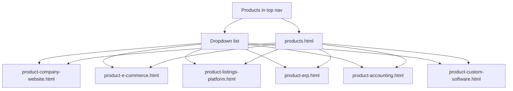
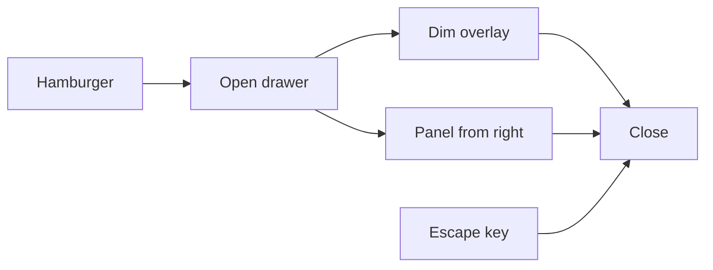

# LiteWeb Static HTML Site

> Saved for offline build. Original Cursor plan: `liteweb_html_site_2fb7f8bc`.

**Overview:** Build a static multi-page LiteWeb site under `html/` from the design mocks, with a unified How-We-Work-style header (right-to-left mobile drawer), **Products in the top nav with a product list**, SCSS architecture with Corporate Precision tokens (including tertiary green), local images, and an npm Sass build.

## Todos

- [ ] **scaffold** — Create package.json, html/ folder tree, SCSS abstracts (colors incl. #72C02C, fonts, 4px button radius)
- [ ] **header-drawer** — Implement unified header + RTL mobile drawer SCSS/JS from how-we-work reference; two-tone LiteWeb logo; **Products top-nav item with dropdown listing all products** (same list in mobile drawer)
- [ ] **images** — Download all mock googleusercontent images into html/images/ with stable filenames (including product pages)
- [ ] **pages-core** — Build index, services, how-we-work, portfolio, pricing HTML + page SCSS
- [ ] **pages-content** — Build about, blog, blog-detail with green accents; link all pages + footer
- [ ] **pages-products** — Build products overview + all product subpages; wire cards and nav dropdown links
- [ ] **build-verify** — Compile CSS, verify links, drawer, Products menu, and responsive layout

## Scope

Convert all design mocks into linked `.html` pages under `html/`:

### Core pages

| Page | Source mock | Output |
|------|-------------|--------|
| Home | `design/liteweb_home_blue_primary` | `html/index.html` |
| Services | `design/liteweb_services_blue_primary` | `html/services.html` |
| How We Work | `design/liteweb_how_we_work` | `html/how-we-work.html` |
| Portfolio | `design/liteweb_portfolio_blue_primary` | `html/portfolio.html` |
| Pricing | `design/liteweb_pricing_blue_primary` | `html/pricing.html` |
| About | `design/liteweb_about_us` | `html/about.html` |
| Blog | `design/liteweb_blog` | `html/blog.html` |
| Blog detail | `design/liteweb_blog_detail` | `html/blog-detail.html` |

### Products (overview + subpages)

| Page | Source mock | Output |
|------|-------------|--------|
| Products overview | `design/liteweb_products_overview` | `html/products.html` |
| Company Website | `design/liteweb_product_company_website` | `html/product-company-website.html` |
| E-Commerce | `design/liteweb_product_e_commerce_1` | `html/product-e-commerce.html` |
| Marketplace / Listings | `design/liteweb_product_listings_platform` | `html/product-listings-platform.html` |
| ERP Software | `design/liteweb_product_erp_software` | `html/product-erp.html` |
| Accounting | `design/liteweb_product_accounting_software` | `html/product-accounting.html` |
| Custom Software | `design/liteweb_product_custom_software` | `html/product-custom-software.html` |

**Skip:** `design/liteweb_product_e_commerce_2` — truncated stub; use `e_commerce_1` only.

### Top navigation

```
Home · Products ▾ · Services · Portfolio · Pricing · Blog · About · [Start a Project]
```

**Products** is a top-level item that:

1. Links to `products.html` (overview / ecosystem hub)
2. Opens a **desktop dropdown** listing every product subpage
3. In the **mobile drawer**, expands to the same product list under Products

Dropdown / drawer product list (labels match overview cards):

| Label | Href |
|-------|------|
| All Products | `products.html` |
| Company Website | `product-company-website.html` |
| E-Commerce | `product-e-commerce.html` |
| Marketplace Platforms | `product-listings-platform.html` |
| ERP Software | `product-erp.html` |
| Accounting | `product-accounting.html` |
| Custom Software Engineering | `product-custom-software.html` |

- Mark **Products** `.is-active` on overview and any product detail page
- Overview bento cards must link to the matching product detail pages (not `#`)
- How We Work stays linked from Home/Services process CTAs (not a top-nav item)



## Design tokens (Corporate Precision)

From style guide + `design/corporate_precision/DESIGN.md`:

- **Primary:** `#3498DB` — CTAs, active nav, brand accent
- **Secondary:** `#2C3E50` — headings / deep text
- **Tertiary (green):** `#72C02C` — success checks, status chips, About/Blog accents (Innovation card, AI category, positive indicators). Included as a first-class SCSS variable and used wherever mocks show green. Products overview uses green on the “Our Solutions” eyebrow.
- **Neutral:** `#F8F9FA` — page background
- Supporting shades as needed (`#006397` deep primary for logo/links if needed, outline greys, white surfaces)
- **Fonts:** Manrope (headlines), Inter (body/labels) via Google Fonts
- **Buttons:** `border-radius: 4px` (`$radius-sm` / `$radius-button`) — slightly rounded, not pills
- **Logo wordmark:** `<span class="logo__lite">Lite</span><span class="logo__web">Web</span>` → Lite in `#3498DB`, Web in `#2C3E50`

## Project layout

```
package.json                 # sass build scripts (repo root)
html/
  index.html … blog-detail.html
  products.html
  product-company-website.html
  product-e-commerce.html
  product-listings-platform.html
  product-erp.html
  product-accounting.html
  product-custom-software.html
  css/main.css               # compiled output (gitignored optional)
  scss/
    main.scss
    abstracts/_variables.scss
    abstracts/_mixins.scss
    abstracts/_functions.scss
    base/_reset.scss
    base/_typography.scss
    base/_base.scss
    layout/_header.scss      # includes Products dropdown
    layout/_drawer.scss      # includes Products expandable list
    layout/_footer.scss
    layout/_grid.scss
    components/_buttons.scss
    components/_forms.scss
    components/_cards.scss
    components/_nav-dropdown.scss
    pages/_home.scss … _blog-detail.scss
    pages/_products.scss
    pages/_product-detail.scss   # shared product detail patterns
  js/
    main.js                  # drawer + header scroll + Products dropdown + UI helpers
  images/                    # downloaded local assets
```

Root `package.json`:

- `sass` as dep
- `"build:css": "sass html/scss/main.scss html/css/main.css --style=expanded"`
- `"watch:css": "sass --watch html/scss/main.scss:html/css/main.css"`
- `"build": "npm run build:css"`

## Unified header + mobile drawer

Base structure from `design/liteweb_how_we_work/code.html` (fixed, frosted `backdrop-filter`, bottom border), adapted once and copied identically on every page (static HTML, works on `file://`):

- Two-tone **LiteWeb** logo → `index.html`
- Desktop nav with `.is-active` underline on the current page
- **Products** item with accessible dropdown (`button` or `aria-haspopup` / `aria-expanded`; hover + click; Escape to close)
- Primary CTA → `#contact` or `how-we-work.html#contact` / pricing as appropriate
- Hamburger (md hidden) opens a **right-edge drawer** that slides **right → left**:
  - Overlay backdrop
  - Panel with nav links + **Products accordion** listing all product pages + CTA
  - Close button / Escape / backdrop click
  - `aria-expanded`, focus trap basics, `body` scroll lock
- SCSS in `_header.scss`, `_drawer.scss`, `_nav-dropdown.scss`; behavior in `html/js/main.js`



## SCSS approach

- All colors/fonts/radii/spacing as variables in `_variables.scss`
- Small partials via `@use` / `@forward` (no giant single file)
- BEM-ish class names (`.site-header`, `.site-header__nav`, `.nav-dropdown`, `.btn`, `.btn--primary`, `.drawer`)
- Page-specific sections only in `pages/_*.scss`
- No Tailwind CDN in the built site — semantic HTML + compiled CSS

## Content & images

- Port section markup/content from each mock into clean semantic HTML (`header`, `main`, `section`, `footer`, proper heading hierarchy)
- Download every `lh3.googleusercontent.com` (and similar) asset into `html/images/` with stable names (`hero-home.webp`, `team-david.webp`, `blog-llm.webp`, `product-erp-hero.webp`, …) and point `src` / CSS `background-image` there
- Material Symbols kept via Google Fonts CDN (icons only)
- Shared footer with internal links + Product Line links to product pages + Privacy/Terms placeholders (`#` for now if no pages)

## JS (single folder)

`html/js/main.js` — modular IIFE or small ES modules:

1. Mobile drawer open/close
2. Products desktop dropdown + mobile accordion
3. Optional header shadow on scroll (from home/services mocks)
4. Blog-detail reading progress bar if present
5. Form submit handlers that `preventDefault` + friendly message (match questionnaire mock)

## Quality bar

- Consistent spacing scale (4/8px), max-width 1280px, gutters from design tokens
- Accessible nav/drawer/dropdown (`button` for menu, labelled)
- Mobile-first breakpoints; desktop matches mocks
- No leftover Tailwind classes or inline style soup — intentional utility only where needed
- Green used on process checks, About Innovation accents, Blog AI category, Products “Our Solutions” eyebrow, and any success UI from mocks — never dropped from the token set

## Implementation order

1. Scaffold `package.json` + SCSS architecture + variables (incl. green + button radius)
2. Build header/drawer/footer + Products dropdown + `main.js`
3. Download images (core + product pages)
4. Implement pages: Home → Services → How We Work → Portfolio → Pricing → About → Blog → Blog detail
5. Implement Products overview + all 6 product detail pages; wire cards and nav
6. Wire all internal links and active states
7. Run `npm run build` and smoke-check desktop + mobile drawer + Products menu

## When you resume

Say something like: **“Implement PLAN.md”** or **“Continue the LiteWeb HTML site build”** and the agent can pick up from the todos above. Design sources live under `design/`.
